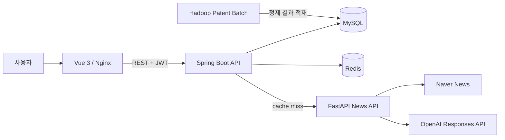

# Jobis — 데이터로 발견하는 강소기업

Jobis는 규모나 인지도만으로는 찾기 어려운 기업을 재무·고용·복지·특허·뉴스 데이터로 탐색하는 서비스입니다. 사용자는 지역과 기업 유형으로 후보를 좁히고, 재무 지표와 청년친화 제도를 비교한 뒤 관심 기업을 저장할 수 있습니다. 기업 선택 월드컵의 결과와 사용자 성향은 다음 탐색 후보를 제안하는 데 사용합니다.

이 저장소는 **2024년 SSAFY 6인 팀 프로젝트**에서 시작했습니다. 정준수는 팀장과 백엔드 개발을 맡아 일정 조율, DB·API 설계와 구현에 참여했습니다. **2026년에는 정준수가 공개 저장소를 독립적으로 현대화**해 인증 경계, 데이터 정합성, 외부 API 안정성, 프런트엔드 품질, 테스트와 실행 환경을 보완했습니다.

## 핵심 기능

- 기업명·지역·기업 유형 검색과 최대 100건의 페이지 조회
- 기업 기본 정보, 재무제표, 재무비율, 분기 고용 지표, 청년친화 제도 조회
- 인증 사용자의 관심 기업 저장과 개인 성향 관리
- 16개 가상 기업 토너먼트와 결과 기반 기업 추천
- 네이버 뉴스 수집, OpenAI 구조화 출력 기반 키워드·감성 분석, Redis 캐시
- 특허 원천 데이터와 기업 기준정보를 결합하는 재현 가능한 Hadoop 배치

## 구조



Spring Boot가 인증과 도메인 규칙을 담당하고, FastAPI는 느리고 실패할 수 있는 뉴스 수집·분석 경계를 분리합니다. Redis는 분석 결과를 기업 ID 단위로 보관합니다. 특허 배치는 서비스 요청 경로에서 분리해 같은 입력으로 같은 결과를 만들 수 있도록 구성했습니다. 자세한 내용은 [아키텍처](docs/architecture.md)와 [데이터 파이프라인](docs/data-pipeline.md)을 참고하세요.

## 기술 구성

| 영역 | 기술 |
| --- | --- |
| Web | Vue 3.5, Vue Router, Pinia, Vite 8, Axios, Chart.js |
| API | Java 17, Spring Boot 3.5, Spring Security, JPA, QueryDSL |
| Data | MySQL 8.4, Redis 7.4, Hadoop 3.5 |
| Analysis | Python 3.13, FastAPI, Pydantic, OpenAI Responses API |
| Delivery | Docker Compose, Nginx, GitHub Actions, Dependabot |

## 현대화 결과

초기 공개본과 같은 환경에서 측정한 비교입니다.

| 항목 | 초기 공개본 | 현재 | 변화 |
| --- | ---: | ---: | ---: |
| 프런트엔드 주 진입 JS | 551 KB | 171 KB | 약 69% 감소, 화면 단위 지연 로딩 |
| 대형 애니메이션 자산 | 42.8 MB GIF | 1.7 MB WebP | 약 96% 감소 |
| npm 알려진 취약점 | 19건 | 0건 | 직접·전이 의존성 갱신 |
| 정적 분석 | 규칙·실행 경로 없음 | ESLint 경고 0 | CI 차단 조건 적용 |
| 뉴스 API 테스트 | 없음 | 9개 | 요청 검증·수집·구조화 분석 경계 검증 |
| 특허 배치 | 로컬 절대경로·복사된 Hadoop 배포본 | 인자 기반 독립 모듈 | 동일 입력 재실행 가능 |

그 밖에 공개 API와 인증 API를 구분하고, 관심 기업의 사용자 소유권과 중복 저장을 보장했으며, 조회수 증가를 원자적 쿼리로 바꿨습니다. 액세스 토큰 갱신 시 리프레시 토큰을 회전하고 HttpOnly 쿠키로 전달합니다. 상세 변경 근거는 [현대화 기록](docs/modernization.md)에 정리했습니다.

## 실행

Docker가 설치된 환경에서 전체 스택을 가장 빠르게 실행할 수 있습니다.

```bash
cp .env.example .env
# .env의 DB_PASSWORD, MYSQL_ROOT_PASSWORD, JWT_SECRET_KEY, OPENAI_API_KEY를 설정
docker compose up --build
```

- Web: <http://localhost:3000>
- API 문서: <http://localhost:8081/api/swagger-ui/index.html>
- Backend health: <http://localhost:8081/api/actuator/health>
- News API 문서: <http://localhost:8000/docs>

MySQL에는 스키마와 기준 데이터가 필요합니다. 개발 환경에서는 `JPA_DDL_AUTO=update`로 테이블을 만들고, 과거 데모 스키마는 [jobis_dump.sql](docs/archive/jobis_dump.sql)을 참고할 수 있습니다. 이 파일은 구조 참고용이며 운영 마이그레이션을 대신하지 않습니다. 소셜 로그인은 사용할 공급자의 Client ID와 Secret을 `.env`에 추가해야 합니다.

각 모듈을 따로 실행하고 검증하는 방법은 [개발 가이드](docs/development.md)에 있습니다.

## 문서

- [요구사항과 완료 기준](docs/requirements.md)
- [API 계약](docs/api.md)
- [아키텍처와 주요 설계 판단](docs/architecture.md)
- [뉴스·특허 데이터 파이프라인](docs/data-pipeline.md)
- [현대화 전후와 검증 근거](docs/modernization.md)
- [코드 학습 가이드](docs/learning-guide.md)
- [원 프로젝트 산출물 목록](docs/output-artifacts.md)

## 검증

```bash
cd backend && ./gradlew clean test
cd frontend && npm ci && npm run lint && npm run build && npm audit --audit-level=high
cd fastapi && python -m ruff check . && python -m pytest
cd hadoop && ./gradlew clean test jar
```

GitHub Actions에서도 같은 네 개 모듈을 독립적으로 검증합니다. 뉴스 수집과 OpenAI 호출은 테스트에서 외부 요청을 모의하므로 API 키가 없어도 품질 검사를 실행할 수 있습니다.
