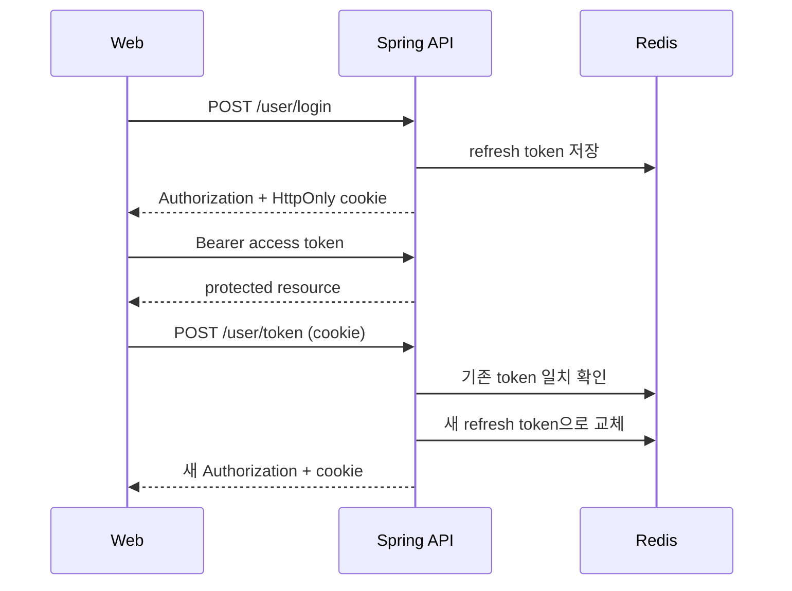

# 아키텍처와 설계 판단

## 컴포넌트 경계

### Vue Web

페이지 이동 시 필요한 화면만 내려받도록 라우트를 동적 import한다. 서버 요청은 공통 Axios 인스턴스를 거쳐 base URL, Bearer 토큰, 토큰 갱신과 오류 처리를 한곳에서 적용한다. 컴포넌트는 API 응답의 `data`를 받은 뒤 표시 책임만 갖는다.

### Spring Boot API

Controller는 경로·입력 검증과 응답 계약을, Service는 트랜잭션과 도메인 규칙을, Repository는 영속성 쿼리를 맡는다. 읽기 서비스는 기본적으로 `readOnly=true`이며 조회수·관심 기업·회원 변경에만 쓰기 트랜잭션을 연다. QueryDSL 검색은 이름·주소·유형 조건을 선택적으로 결합하고 이름과 ID를 고정 정렬 기준으로 사용한다.

### MySQL과 Redis

MySQL은 사용자, 기업, 지표, 관심 기업, 추천 관계의 기준 저장소다. 관심 기업에는 사용자와 기업 조합의 유일성이 필요하고 서비스에서도 중복을 확인한다. Redis는 리프레시 토큰과 뉴스 분석 결과처럼 수명과 재생성 가능성이 있는 데이터를 담당한다.

### News API

뉴스 수집과 LLM 분석은 지연과 실패 양상이 일반 DB 조회와 다르므로 Python 서비스로 격리한다. 동기 라이브러리 호출은 FastAPI thread pool에서 실행해 이벤트 루프를 막지 않는다. Naver 검색 전체, 개별 기사, OpenAI 호출에 각각 timeout과 처리량 상한을 둔다.

### Patent Batch

대용량 특허 원천 파일은 요청마다 가공하지 않는다. Gradle로 고정한 Hadoop 의존성과 명시적 입·출력 인자로 map-only 작업을 실행한다. 분산 캐시의 기업 기준 CSV를 읽어 사업자번호로 매칭하고, 유효하지 않거나 매칭되지 않은 행은 카운터로 관찰한다.

## 인증 순서

리프레시 토큰은 JavaScript에서 읽지 못하는 쿠키로 제한하고 서버 저장값과 정확히 일치해야 한다. 갱신 성공 시 기존 토큰을 즉시 대체해 탈취 토큰의 재사용 범위를 줄인다. 인증 실패와 권한 부족은 HTML 리디렉션 대신 동일한 JSON 오류 계약으로 응답한다.

## 장애 경계

- 뉴스 캐시가 있으면 외부 서비스를 호출하지 않는다.
- 캐시가 없고 외부 분석이 실패하면 Spring API는 502 의미의 도메인 오류를 반환한다.
- 존재하지 않는 기업, 사용자, 추천 관계는 빈 정상 응답으로 숨기지 않고 404로 구분한다.
- 한 요청의 페이지 크기를 100으로 제한해 무제한 조회를 막는다.
- 운영 프로필은 `ddl-auto=validate`로 코드와 DB 스키마 불일치를 시작 시점에 감지한다.

## 결정 기록

- [리프레시 토큰 회전과 쿠키 저장](decisions/0001-refresh-token-rotation.md)
- [뉴스 분석 서비스 분리](decisions/0002-news-service-boundary.md)
